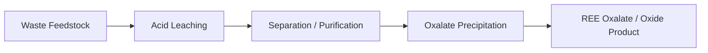
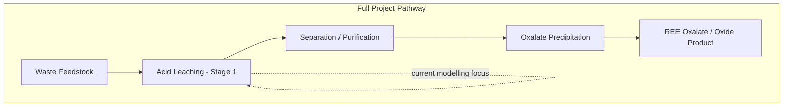

# Data-Driven Prediction of Rare-Earth Element Recovery from Waste (Stage 1: Acid Leaching)

A B.Tech Chemical Engineering research project (BTP) investigating whether literature-derived experimental data can be used to predict rare-earth element (REE) recovery during acid leaching of real waste feedstocks — as the foundation for an eventual data-driven recovery pathway from waste to REE oxalate/oxide product.

**Status:** Dataset validation & physicochemical mechanism analysis (pre-ML-modelling stage). See [Current Project Status](#current-project-status).

---

## Research Question

> Can literature data be used to predict REE recovery during acid leaching across different acids, feedstocks, REEs, and operating conditions?

## Motivation

REEs — particularly Nd, Pr, Dy, Tb, and Y — are critical to permanent magnets, EV motors, wind turbines, and consumer electronics, yet primary supply is geographically concentrated. Recovering REEs from waste (spent magnets, spent batteries) is a real, implementable secondary-supply route. Acid-leaching studies for this purpose already exist in the literature, but they are scattered across different acids, feedstocks, and reporting conventions, and no single framework currently predicts recovery outcomes across them. This project asks whether a data-driven model, trained on literature-derived experimental data, can learn the joint pattern of acid identity, feedstock, REE identity, and operating conditions that governs recovery — rather than relying on a single mechanistic rule.

## Overall Recovery Pathway

The full envisioned recovery pathway spans four stages:



## Current Research Focus

**This repository currently covers Stage 1 (Acid Leaching) only.** The overall project pathway includes downstream separation/purification and oxalate precipitation, but those stages are **not** part of the current modelling scope. Leaching efficiency is treated as the foundational, rate-limiting first step: it bounds what is achievable downstream, so it is being characterised and modelled first. Only literature records whose reported process is consistent with the full real-feedstock → leaching → downstream oxalate-precipitation pathway are included in the dataset (see [Literature Dataset Construction](#literature-dataset-construction)); the recovery numbers used as the current modelling target are Stage-1 (leaching) recovery values only, not downstream-stage results.

## Scientific Scope

The scope below is locked for the current phase of the project. Full rationale and exclusions are documented in [`docs/scope.md`](docs/scope.md).

### Feedstocks
- NdFeB magnet waste (including magnet swarf / hydrogen-decrepitation stage material)
- Spent NiMH batteries

### REEs
| Symbol | Element | Role |
|---|---|---|
| Nd | Neodymium | Preferred primary modelling target |
| Pr | Praseodymium | Retained when directly reported |
| Dy | Dysprosium | Retained when directly reported |
| Tb | Terbium | Retained when directly reported |
| Y | Yttrium | Retained when directly reported |

Total/aggregate REE values are retained as a secondary, coarser observation when a paper reports only a combined figure. Aggregate values are **never** silently converted into an individual-element recovery number.

### Acids
10 acids are locked in scope: **HCl, H₂SO₄, HNO₃, H₃PO₄, citric acid, acetic acid, malic acid, glycolic acid, maleic acid, ascorbic acid**. DES and ionic-liquid leaching routes are explicitly excluded. As of the current evidence pool, **glycolic acid and maleic acid have zero represented observations** — they are locked into scope for future literature collection but are not yet present in the data (see [Dataset Status](#dataset-status)).

### Stage-1 variables
Feedstock, acid, acid concentration, pH, leaching temperature, leaching time, solid:liquid / liquid:solid ratio, agitation/stirring speed, particle size, number of leaching stages/cycles, feedstock composition, REE composition, Fe/Ni/Co/B impurity data (where reported), Fe:REE ratio (where supported), REE identity, Stage-1 recovery/extraction, DOI/paper source, and provenance metadata.

## Literature Dataset Construction

Records are drawn from published studies where a real waste feedstock (not a synthetic REE solution) undergoes acid leaching as part of a pathway that includes, or is corroborated to include, downstream oxalic-acid/oxalate precipitation — see [`docs/scope.md`](docs/scope.md) for the full inclusion logic. Each usable record is extracted with its DOI, source paper, and group/paper identifier retained for provenance and reproducibility. The dataset explicitly separates:

- **CORE** observations — a directly reported numerical Stage-1 recovery/extraction percentage for a specific element.
- **REVIEW-type** observations — approximate values, aggregate-only values, inequality statements, or records with incomplete operating conditions, kept but flagged rather than treated as equivalent to CORE data.

pH, when reported, is recorded as reported — it is **never inferred from acid concentration**. No operating condition or recovery value is fabricated, extrapolated from a graph without explicit source support, or derived from concentration without a complete, explicit mass balance. Full detail is in [`data/README.md`](data/README.md).

## Dataset Status

Two dataset snapshots exist in the project history and are both included in this repository (`data/raw/`) for transparency:

| Snapshot | File | Rows | Notes |
|---|---|---|---|
| **Current evidence pool (primary)** | `REE_Stage1_MASTER_All_Claude_Datasets_Unique.xlsx` | 413 unique rows (mechanically merged from 453 raw rows across 6 source datasets) | Matches the papers, acids, and per-acid/per-REE observation counts used in the current presentation and recovery plots (see [Preliminary Analysis](#preliminary-analysis)). Includes a `feat_leach_pH` field (currently almost entirely "not reported") and placeholder QC columns (`Quality_Tier`, `Data_Type`, `Downstream_Oxalate_Step_Confirmed`) that are **not yet populated**. |
| Earlier/parallel curated snapshot | `REE_Stage1_MASTER_All_Unique_Datasets_For_Professor.xlsx` | 277 unique rows total; 241 rows after filtering strictly to NdFeB + NiMH scope; 36 rows kept separately as identified out-of-scope (fluorescent-lamp phosphor, red-mud/bauxite residue) | Includes an explicit `Manual_Review` worklist (94 rows) and a `Feature_Dictionary` sheet. Does **not** include a pH field and does not match the row counts underlying the current plots/presentation. |

**Current literature evidence pool; final ML-ready dataset is under validation.** Neither snapshot should be treated as the final, strict ML-training dataset — both are evidence pools at different stages of curation. Full detail, including how this determination was made, is in [`data/README.md`](data/README.md).

## Methodology



Full methodology, including the planned ML pipeline, is documented in [`docs/methodology.md`](docs/methodology.md).

## Preliminary Analysis

Preliminary analysis is based on four evidence plots generated from the current dataset (`analysis/recovery_plots/`), covering HCl, citric acid, Dy, and Nd.

- **HCl:** generally high recovery (mostly 85–100%) across the reported concentration range, with some lower-recovery exceptions; noticeably less scatter than the organic acids reviewed.
- **Citric acid:** the most heavily represented acid in the current evidence pool (n ≈ 72–81 observations per REE); shows large recovery scatter (roughly 12–100%) even at near-identical concentrations — concentration alone does not explain the spread.
- **Dy:** reported recovery spans roughly 12–100% depending on acid and concentration; the spread is wider than for HCl alone, suggesting element identity affects the shape of the recovery relationship, not just its average.
- **Nd (primary target):** spans a wide range (under 20% to ~100%); both HCl/H₂SO₄ and citric acid can reach high recovery at some conditions, and no single acid or concentration rule captures the full pattern.

These are preliminary literature-data observations, not causal claims. Full discussion is in [`analysis/README.md`](analysis/README.md).

## Physicochemical Framework

Several literature-supported factors are candidates for explaining why recovery is not uniformly 100% across conditions: proton activity, ligand complexation, anion chemistry, precipitation/passivation, feedstock composition and impurity effects, temperature/time/kinetic effects, solid–liquid mass transfer, and particle size/physical accessibility. These are treated as plausible, literature-supported hypotheses that motivate multivariate modelling — not as a proven, single controlling mechanism. pKa/acid concentration alone does not explain the observed recovery scatter in the current evidence.

## Planned ML Pipeline


No ML modelling has been performed yet. See [Current Project Status](#current-project-status).

## Repository Structure

```
REE-Recovery-ML/
│
├── README.md
├── requirements.txt
├── .gitignore
│
├── data/
│   ├── README.md
│   ├── raw/
│   │   ├── REE_Stage1_MASTER_All_Claude_Datasets_Unique.xlsx
│   │   └── REE_Stage1_MASTER_All_Unique_Datasets_For_Professor.xlsx
│   └── metadata/
│       └── data_dictionary.md
│
├── analysis/
│   ├── README.md
│   └── recovery_plots/
│       └── REE_Individual_Element_Recovery_Plots.pdf
│
├── presentation/
│   └── REE_Stage1_Project_Overview.pptx
│
├── src/
│   └── load_dataset.py
│
└── docs/
    ├── methodology.md
    └── scope.md
```

## Installation

```bash
git clone https://github.com/<your-username>/REE-Recovery-ML.git
cd REE-Recovery-ML
python -m venv .venv
source .venv/bin/activate        # Windows: .venv\Scripts\activate
pip install -r requirements.txt
```

## Usage

The repository currently ships data, documentation, and a reproducibility loader script — no trained model yet exists. To inspect the current evidence pool:

```bash
python src/load_dataset.py
```

This loads `data/raw/REE_Stage1_MASTER_All_Claude_Datasets_Unique.xlsx`, reports row counts, per-acid and per-feedstock breakdowns, and a CORE-vs-REVIEW / manual-review-flag summary. It performs no imputation, filtering-to-final, or modelling — it is a QC/inspection utility only.

## Reproducibility

- All Stage-1 records retain DOI, source paper, and group/paper identifier.
- Deduplication logic and source-file provenance for the 413-row evidence pool are recorded in the `Merge_Summary` and `Dedup_Audit` sheets of `REE_Stage1_MASTER_All_Claude_Datasets_Unique.xlsx`.
- Equivalent provenance for the 277-row snapshot is recorded in its `Source_Version_Audit` and `Dedup_Audit` sheets.
- No random-seed-dependent steps exist yet (no modelling has been performed).

## Future Work

1. Dataset Validation & Mechanism Analysis *(current stage)*
2. Final Dataset & QC — resolve the two snapshots into a single validated, ML-ready dataset; populate/standardise the currently-empty `Quality_Tier`, `Data_Type`, and `Downstream_Oxalate_Step_Confirmed` fields; collect pH data, which is almost entirely unreported in the current evidence pool
3. Preprocessing & Feature Engineering
4. ML Modelling
5. Evaluation & Explainability
6. Optimization / Prediction
7. Integration with Downstream Pathway (separation/purification, oxalate precipitation)

## References

Verified studies currently represented in the dataset (see [`docs/scope.md`](docs/scope.md) for inclusion logic):

- Das et al., 2026, *Journal of Rare Earths*. [10.1016/j.jre.2026.03.013](https://doi.org/10.1016/j.jre.2026.03.013)
- Romano et al., 2024, *Metals*. [10.3390/met14080932](https://doi.org/10.3390/met14080932)
- Romano et al., 2023, *Metals*. [10.3390/met13111801](https://doi.org/10.3390/met13111801)
- Korkmaz et al., 2018, *Metals*. [10.3390/met8121062](https://doi.org/10.3390/met8121062)
- Yang et al., 2014, *Journal of Hazardous Materials*. [10.1016/j.jhazmat.2014.07.027](https://doi.org/10.1016/j.jhazmat.2014.07.027)
- Otron et al., 2024. [10.1080/09593330.2023.2243391](https://doi.org/10.1080/09593330.2023.2243391)
- Li et al., 2025, *The Canadian Journal of Chemical Engineering*. [10.1002/cjce.25639](https://doi.org/10.1002/cjce.25639)

The dataset draws on additional literature sources beyond this list (74 unique DOIs / 119 paper-label entries in the current evidence pool); the papers above are the subset explicitly verified and named in the project brief. This is not a claim that these are the only, or the complete, literature base.

## Disclaimer / Data Notes

This dataset is assembled from heterogeneous literature sources with different reporting conventions (units, temperature scales, particle-size descriptions, aggregate-vs-per-element recovery, etc.). Fields have been normalised where the source supports it and left as "not reported" (`NR`) otherwise — never estimated or backfilled. The dataset is a **literature evidence pool**; its suitability for final ML training is still under validation, and several QC fields (data-quality tier, downstream-oxalate confirmation) are defined in the schema but not yet populated for the current evidence pool. Results, models, and conclusions described elsewhere in this repository as "planned" or "future work" have **not** been produced yet — no ML modelling has occurred.

## Author

Sohel Bhongade
B.Tech Chemical Engineering, IIT Indore
