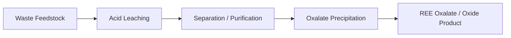
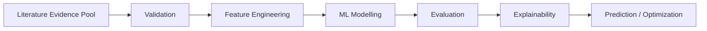

# Methodology

## 1. Full Project Pathway vs. Current Focus

The eventual, full recovery pathway targeted by this project is:



**The current research focus is Stage 1 — Acid Leaching only.** Downstream separation/purification and oxalate precipitation are part of the overall project pathway and are used as an *inclusion criterion* for the literature dataset (see below and [`scope.md`](scope.md)), but they are **not** the subject of the current predictive-modelling work, and no data or claims about downstream-stage performance are part of the current Stage-1 target variable.

Leaching is treated as the foundational step because its efficiency bounds what is achievable at every later stage; establishing whether literature data can predict Stage-1 recovery is therefore a meaningful, self-contained modelling target before extending to later stages.

## 2. Why This Project Pathway (Inclusion Logic)

The literature dataset is not intended to contain every published REE-leaching study. A record is included only if it follows the pathway:

```
Real waste feedstock → Stage-1 acid leaching → downstream recovery pathway involving oxalic-acid / oxalate precipitation
```

Rationale: this keeps every collected data point relevant to a common, real, implementable recovery route, rather than diluting the dataset with mechanistically interesting but practically disconnected chemistries. Synthetic REE solution experiments (no real waste feedstock) do not satisfy this requirement on their own. Studies that use an alternative downstream route without the required oxalate stage are not treated as equivalent to in-scope studies. Stage-2/Stage-3 (downstream) recovery numbers are never used as, or leaked into, the Stage-1 target.

**Current data-quality caveat:** the schema field intended to record downstream-oxalate-step confirmation per row (`Downstream_Oxalate_Step_Confirmed` / `Oxalate_Step_Evidence`) exists in the current evidence pool but is **not yet populated** for any row. Pathway-consistency was applied at the point of literature selection, but is not currently re-verifiable on a per-row basis from the dataset file alone. This is tracked as an open QC item (see [Future Work](../README.md#future-work)).

## 3. Why Stage 1 First

Acid leaching is the step that determines how much REE mass is even available to downstream stages. Establishing a predictive relationship for Stage-1 recovery — across feedstocks, acids, and REEs — is treated as the necessary first deliverable before attempting to model or optimise the full pathway.

## 4. Current Scientific Question

> "Why is REE recovery not 100%?"

Literature-based candidate mechanisms currently under consideration (not treated as settled/causal — see [`scope.md`](scope.md) and the main [README](../README.md#physicochemical-framework)):

1. Proton activity
2. Ligand complexation
3. Anion chemistry
4. Precipitation / passivation
5. Feedstock composition and impurity effects
6. Temperature/time/kinetic effects
7. Solid–liquid mass transfer
8. Particle size and physical accessibility

The project also examined acid physicochemical descriptors (pKa, acid strength, proton availability, ligand functionality, complexation potential, anion chemistry, solubility/precipitation behaviour) as candidate feature-engineering variables. Current conclusion: pKa or acid concentration alone does not explain the observed recovery scatter in the current evidence pool — these properties are being treated as candidate features for a multivariate model, not as a single controlling factor.

## 5. Data Quality Philosophy

Quality is prioritised over quantity. The primary target category is:

**CORE** = a directly reported numerical Stage-1 recovery/extraction percentage for a specific record.

**REVIEW-type** records are retained but distinguished, and may include approximate values, aggregate-only (not per-element) values, inequality statements, ambiguous conditions, or incomplete operating-condition reporting. DOI, source paper, group/paper ID, provenance, and data-quality information are preserved for every record. The dataset is presented as an **evidence pool**, not as a set of rows that are automatically suitable for final ML training as-is — see [`data/README.md`](../data/README.md) for the CORE/REVIEW breakdown found in the current files.

## 6. Planned ML Pipeline



Stage descriptions:

| Stage | Description | Status |
|---|---|---|
| Dataset Validation & Mechanism Analysis | Validating the assembled evidence pool; analysing which physicochemical factors may explain recovery scatter | **Current stage** |
| Final Dataset & QC | Reconciling the two existing snapshots into one validated dataset; populating currently-empty QC fields | Not started |
| Preprocessing & Feature Engineering | Encoding categorical features (acid, feedstock), handling missing values, building descriptors (e.g. Fe:REE ratio) | Not started |
| ML Modelling | Not started | Not started |
| Evaluation & Explainability | Not started | Not started |
| Optimization / Prediction | Not started | Not started |
| Integration with Downstream Pathway | Not started | Not started |

No model has been trained, evaluated, or benchmarked. Any reference elsewhere in this repository to model performance, accuracy, or "results" would be a forward-looking statement about future work, not a completed result — no such claims are made here.

## 7. Reproducibility Notes

- Every record in the evidence pool retains DOI, source paper text ("Paper"), and a `group_paper_id`/`Final Row ID` for traceability back to source literature.
- The 413-row evidence pool's merge/deduplication logic is auditable via the `Merge_Summary` and `Dedup_Audit` sheets in `data/raw/REE_Stage1_MASTER_All_Claude_Datasets_Unique.xlsx`.
- The 277-row snapshot's provenance is auditable via its `Source_Version_Audit` and `Dedup_Audit` sheets.
- `group_paper_id` is intended as a grouping key for paper-aware cross-validation (e.g. GroupKFold / leave-one-paper-out) once modelling begins, since several papers contribute multiple rows sharing feedstock/conditions — plain random k-fold would leak information across rows from the same paper.
